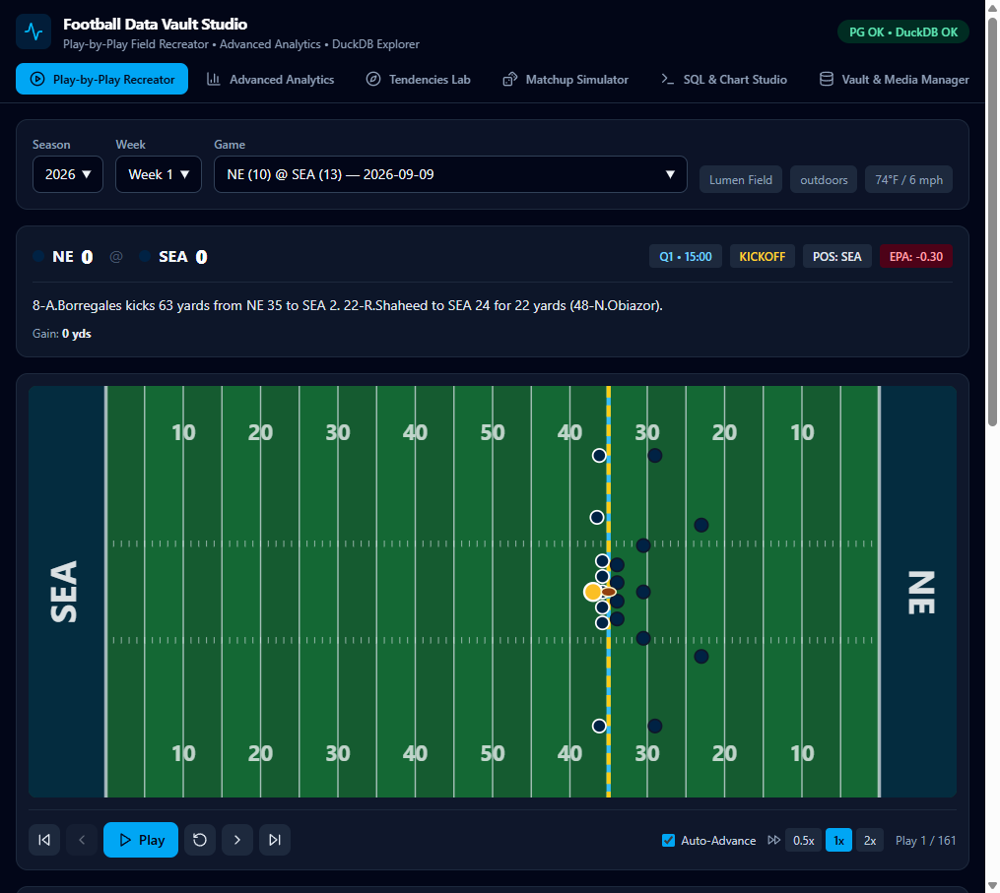
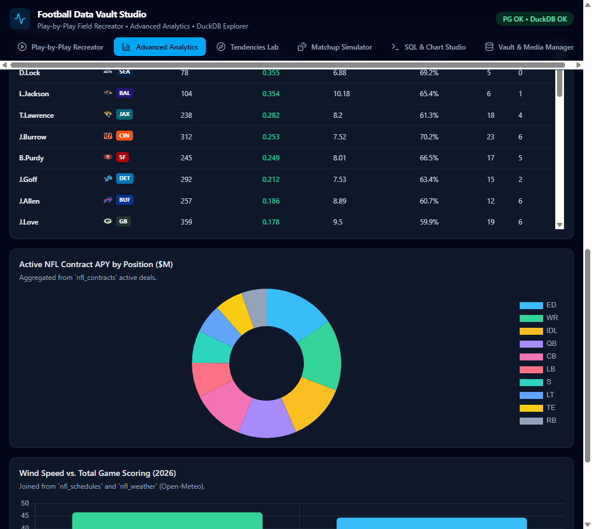
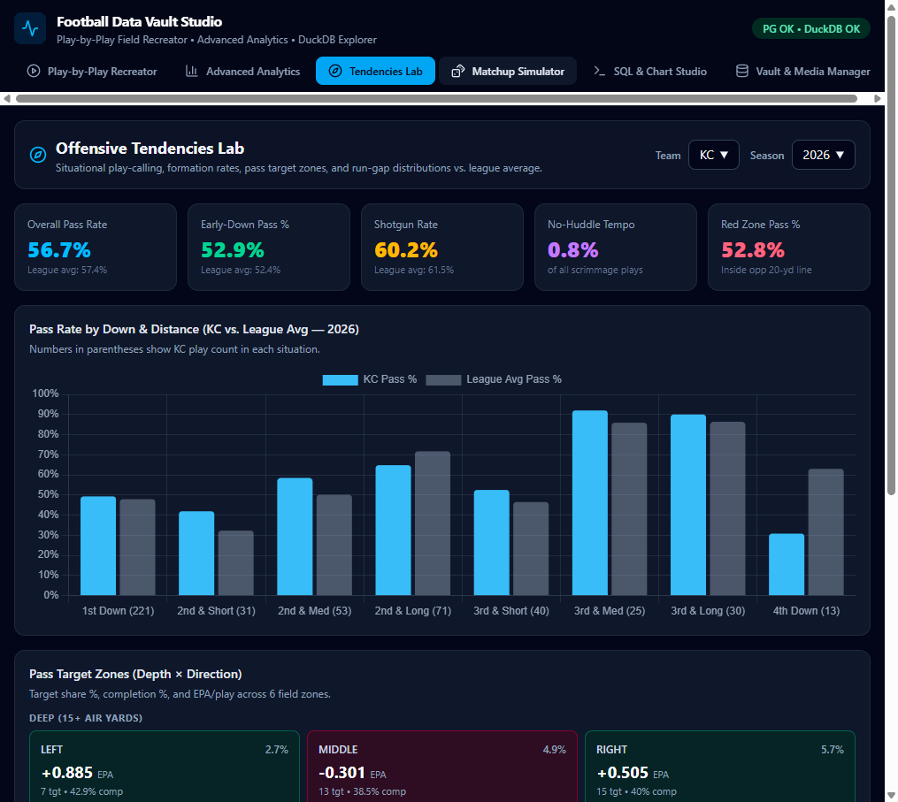
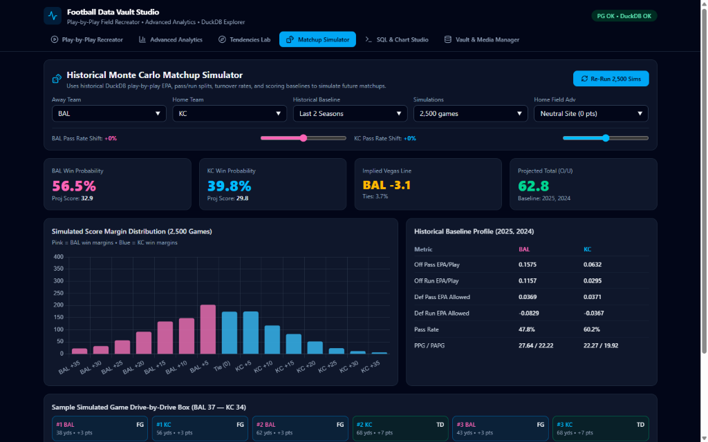

# Ultimate Football Data Vault

A self-hosted, Dockerized personal football data vault combining:
- **PostgreSQL 18** (`nfl`, `cfb`, `fantasy`, `media` schemas) for relational metadata, ingestion logs, CFB/Sleeper records, and media asset indexing.
- **DuckDB 2.0 + Parquet** (`/data/parquet` & `/data/duckdb/vault.duckdb`) for fast analytical queries over `nflverse` play-by-play, rosters, contracts, draft, combine, and CFB datasets.
- **Local Media Vault** (`/data/media/{audio,images,video}`) for archiving public-domain/CC media files alongside link-only metadata for copyrighted streams (YouTube, NFL+).

## Quick Start

1. **Create `.env` from the template:**
   ```powershell
   Copy-Item .env.example .env
   ```
   Edit `.env` to set a strong `POSTGRES_PASSWORD`, and optionally add your `CFBD_API_KEY` (from https://collegefootballdata.com/key) and `SLEEPER_USERNAME` / `SLEEPER_LEAGUE_IDS`.

2. **Start the Docker Compose stack:**
   ```powershell
   docker compose up -d --build
   ```
   All services bind strictly to `127.0.0.1` (`5433` by default for PostgreSQL, `8000` for `vault-api`, and `3000` for `vault-web`).
   To run only the backend (`postgres` + `vault-api`) without the optional Studio container:
   ```powershell
   docker compose up -d --build postgres vault-api
   ```

3. **Verify health:**
   ```powershell
   curl http://127.0.0.1:8000/health
   ```

4. **Run initial data syncs:**
   ```powershell
   # Sync NFL schedules, rosters, stats, PBP, injuries, contracts, draft, combine
   docker compose exec vault-api python -m vault.cli sync-nfl --seasons 2024 2025

   # Sync Sleeper NFL player directory + your configured leagues
   docker compose exec vault-api python -m vault.cli sync-sleeper

   # Sync College Football (requires CFBD_API_KEY in .env)
   docker compose exec vault-api python -m vault.cli sync-cfb --seasons 2024 2025
   ```

5. **Query DuckDB directly:**
   ```powershell
   docker compose exec vault-api python -m vault.cli query "SELECT season, COUNT(*) AS games FROM nfl_schedules GROUP BY season ORDER BY season"
   ```

6. **Add local media:**
   Drop public-domain/CC files into `./data/media/audio`, `./data/media/images`, or `./data/media/video`, then run:
   ```powershell
   docker compose exec vault-api python -m vault.cli scan-media
   ```
   For copyrighted/DRM streams (NFL+, YouTube), register them as link-only metadata via `POST http://127.0.0.1:8000/media/register` with `"is_local_file": false`.

## Optional: Football Data Vault Studio (Separate Docker Container)

The `vault-web` service (`football_vault_web`) runs **Football Data Vault Studio**—a standalone React + Vite + Chart.js frontend served by Nginx in its own container (`./web/Dockerfile`). It includes:
- **Play-by-Play Recreator** — Interactive field canvas with drive/play playback, EPA/WPA telemetry, and win probability timeline.
- **Advanced Analytics** — 32-team EPA efficiency matrix with official NFL logos & colors, multi-position leaderboards, contract APY breakdown, and weather impact charts.
- **Tendencies Lab** — Situational pass/run rates vs. league average, depth × direction pass target zones, and run-gap efficiency.
- **Matchup Simulator** — Historical Monte Carlo game simulator (2,500+ simulations) with score margin distributions and drive-by-drive box scores.
- **SQL & Chart Studio** — Direct DuckDB SQL workbench with instant charting.
- **Vault & Media Manager** — Ingestion status, one-click syncs, and local/link-only media indexing.

### Screenshots

#### Play-by-Play Recreator


#### Advanced Analytics


#### Tendencies Lab


#### Matchup Simulator


### Setup & Commands

1. **Build and start the Studio container** (alongside `vault-api` and `postgres` if not already running):
   ```powershell
   docker compose up -d --build vault-web
   ```
   > **Note:** `vault-web` binds strictly to `127.0.0.1:3000` (`127.0.0.1:3000:80`) and proxies `/api/*` requests to `http://vault-api:8000/` over the internal `vault_net` Docker bridge network.

2. **Open the Studio in your browser:**
   ```text
   http://127.0.0.1:3000
   ```

3. **View Studio logs or stop only the Studio container:**
   ```powershell
   # Follow Nginx / web container logs
   docker compose logs -f vault-web

   # Stop only the Studio container while keeping postgres and vault-api running
   docker compose stop vault-web
   ```
